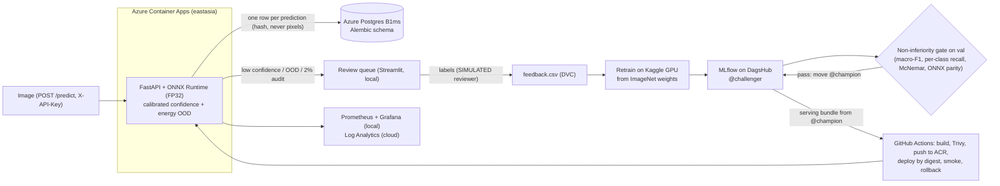
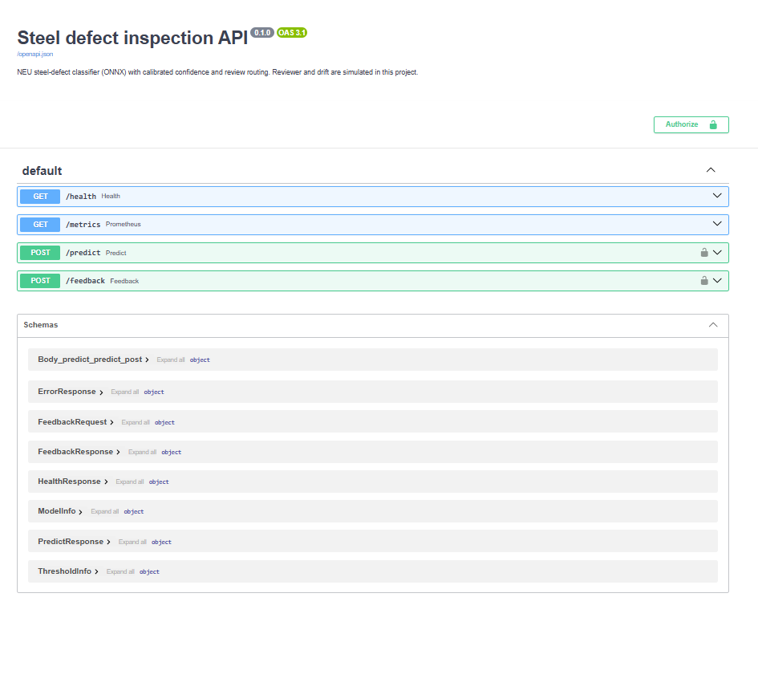
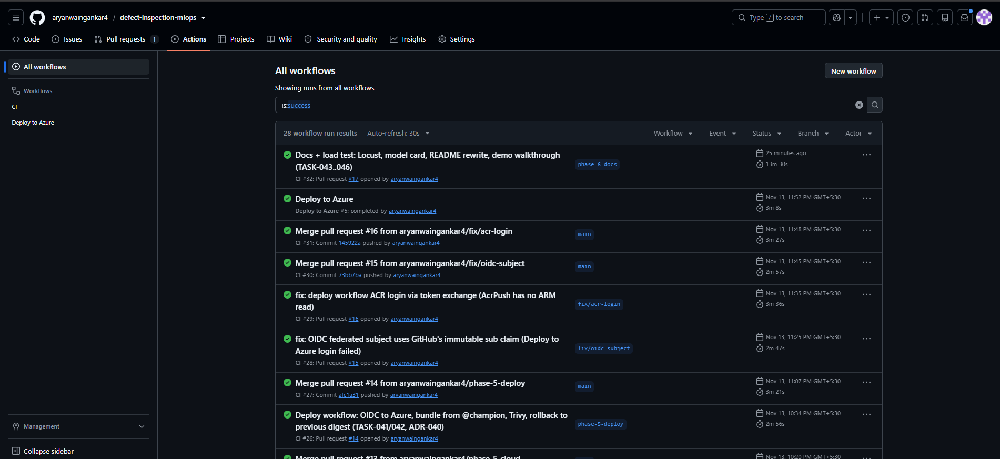

# SteelSentry: a self-improving steel defect inspection system

[](https://github.com/aryanwaingankar4/defect-inspection-mlops/actions/workflows/ci.yml)
[](https://github.com/aryanwaingankar4/defect-inspection-mlops/actions/workflows/deploy-azure.yml)

A steel-surface defect classifier that sends uncertain images to a human, retrains on the corrections, and ships a new model only after a statistical gate shows it is **not worse**. It is served as FP32 ONNX behind FastAPI on Azure Container Apps, and deployed from `main` by GitHub Actions with OIDC (no stored Azure secret).

> Portfolio project on the public NEU dataset, not a factory deployment. **Every number in this README comes from a committed file in `results/`, linked next to it.**

## Real vs simulated

| Real | Simulated |
|---|---|
| Training on a Kaggle GPU; MLflow registry on DagsHub; promotion-gate decisions (`results/promotion/`) | **The reviewer:** dataset labels with a seeded 0% / 5% error rate |
| ONNX serving, the prediction log in Postgres, the Azure deployment, CI/CD and rollback | **Production traffic:** a held-out split (`production_stream`) streamed through the API |
| Leakage audit, calibration, OOD threshold, risk bound | **The fault-injection run:** a broken reviewer that shifts every label |

## Architecture



## Results

| What | Result | Source |
|---|---|---|
| Leakage audit | 193 near-copy pairs crossed split v1 (pHash found none); group-aware split v2 has 0 | `results/archive/split_v1/near_duplicates_cnn_summary.json`, `results/near_duplicates_cnn_summary.json` |
| Effect of the leak fix | val macro-F1 0.9890 (v1, leaky) → 0.9780 (v2, honest) | `results/archive/split_v1/train/val_metrics.json`, `results/train/val_metrics.json` |
| Model choice | EfficientNet-B0 kept; McNemar vs MobileNetV3 on val p = 0.375 | `results/compare/val_mcnemar.json` |
| `test_frozen` macro-F1, first champion v2 | 0.9917 [0.9808, 1.0000], 3 / 360 errors | `results/loop/final_test_frozen.json` |
| `test_frozen` macro-F1, current champion v5 | 0.9972 [0.9912, 1.0000], 1 / 360 errors | `results/loop/final_test_frozen.json` |
| v5 − v2 | +0.0055 [+0.0000, +0.0141]: not a proven gain | `results/loop/final_test_frozen.json` |
| Review routing (v5) | 5% of val routed; error-rate upper bound on accepted images 0.0274 | `results/retrain/9b1c9dbd6d464eb291ba2605b3f35de6/threshold.json` |
| INT8 vs FP32 | val macro-F1 0.4264 vs 0.9780, so INT8 rejected and FP32 serves | `results/onnx/quantization_report.json` |
| API image | 138.5 MB, non-root, no torch | `results/docker/image_report.json` |
| Cloud smoke | passed (health, golden `/predict`, 401 without key), p50 562.6 ms from a GitHub runner | `results/cloud/deploy_report.json` |
| Rollback drill | broken image fails `/health`, previous digest redeployed, smoke passes | `results/cloud/rollback_drill.json` |
| Load test (Locust, 20 users, 2 min) | 1,781 requests, 14.84 req/s, p50 170 ms / p95 910 ms / p99 1,500 ms, 0 errors (1 replica, 0.5 vCPU, nothing tuned) | `results/load/locust_report.json` |

The load test's p50 is lower than the smoke's sequential p50. A likely reason: Locust reuses HTTPS connections, while the smoke opens a new connection per request.

The full model card is in [`docs/MODEL_CARD.md`](docs/MODEL_CARD.md).

## The loop (simulated stream and reviewer)

Source: [`results/loop/README.md`](results/loop/README.md), generated from `results/loop/loop_summary.json`.

| Cycle | Labels used | Reviewer error | Val macro-F1 (champion vs challenger) | Verdict |
|---|---|---|---|---|
| 1 (pilot) | 67 | 0% | v2 0.9780 vs v3 0.9944 | promote |
| 2 | 95 | 0% | v3 0.9944 vs v4 1.0000 | promote |
| 3 | 121 | 5% | v4 1.0000 vs v5 0.9944 | promote (non-inferior) |
| fault injection | 121, all shifted | broken | v5 0.9944 vs v6 0.7428 | stopped before the gate by the risk check |

A rollback was also exercised on the registry: v3 → v2 → v3 (`results/promotion/rollback_20261112T011313Z.json`, `results/promotion_log.json`).

## Cloud and CI/CD

- **Azure (ADR-039, `infra/`):** everything is Bicep in `rg-steelsentry`, region eastasia. Postgres B1ms was not offered in uaenorth (`make pg-probe`).
  - Container Apps: min 0 / max 1 replicas.
  - ACR: admin user off; images are pulled with a managed identity.
  - Postgres Flexible B1ms: PG 16, TLS required.
  - Log Analytics, plus a $10 budget alert.
- **CI (`.github/workflows/ci.yml`):** ruff, the fast tests, migrations and DB tests on a Postgres service container, and Trivy.
- **Deploy (`.github/workflows/deploy-azure.yml`, ADR-040):** runs after CI succeeds on `main`, or manually. Steps:
  1. Log in with GitHub **OIDC** to a managed identity (AcrPush, plus Container Apps Contributor scoped to the resource group).
  2. Build the serving bundle from `@champion`.
  3. Build the image and scan it with Trivy.
  4. Push to ACR tagged with the git SHA.
  5. Deploy **by digest** and run the cloud smoke.
  6. If the smoke fails, **redeploy the previous digest**, re-check, and fail the run.
- **Latest green deploy:** recorded in `results/cloud/deploy_report.json` (`workflow_run_url`).

## How to run

Needs Python 3.11, [uv](https://docs.astral.sh/uv/), Docker and GNU Make. NEU data is private (ADR-015), so steps that need images only work with your own copy.

```bash
make setup                 # .venv from the lockfile
cp .env.example .env       # fill in API_KEY, AUDIT_SALT, ... (never commit .env)
make check                 # ruff + fast tests (what CI runs)

make serving-bundle        # @champion ONNX + manifest from MLflow (needs DagsHub read access)
make serve                 # API on http://127.0.0.1:8000 (docs at /docs)
make docker-smoke          # build the image, check it, remove it (synthetic image only)
make docker-up             # API + Prometheus :9090 + Grafana :3000

make stream N=40           # SIMULATED traffic into the local API
make review-ui             # review queue on http://127.0.0.1:8501
make simulate-review       # SIMULATED reviewer
make feedback-export && make retrain && make gate   # one loop cycle (Kaggle GPU)

make azure-up && make azure-deploy   # Azure infra + first deploy (ADR-039)
make load-test             # Locust against the Azure URL (synthetic image only)
make pg-stop / make pg-start          # stop Postgres when idle (saves cost)
```

## Demo walkthrough

No video; follow these steps instead (TASK-046).

1. **API docs.** Open `<Azure URL>/docs`, where the URL is in `results/cloud/deploy_report.json`. `GET /health` shows model v5, `fp32` and `database: ok`. `POST /predict` without a key returns 401; with a key and `tests/golden/synthetic_golden.png` it returns `scratches` with calibrated confidence 0.990.
   
2. **CI/CD.** In GitHub Actions, CI passes on `main` and then "Deploy to Azure" runs. Show the Trivy summary, the push by SHA, the deploy by digest and the smoke step.
   
3. **Review loop (local, simulated).**
   - `make serve`, `make stream N=40`, `make review-ui`.
   - A review card shows the image, the prediction, the calibrated confidence, the OOD score and why it was routed: low confidence, OOD or audit.
   - Audit cards are blind: they hide the prediction.
4. **Monitoring.** `make docker-up`, send traffic, then open Grafana on :3000. The dashboard (`monitoring/grafana/dashboards/defect-api.json`) has requests per second, `/predict` latency, calibrated confidence, energy (OOD score), routing reasons, review queue size and log write failures.
5. **Gate and rollback.** Open `results/loop/README.md` (each cycle's verdict) and `results/cloud/rollback_drill.json` (the broken image rolled back).

## Key decisions

All 40 are in [`docs/DECISIONS.md`](docs/DECISIONS.md). The ones that shape the results:

| ADR | Decision |
|---|---|
| 021 | Group-aware split: overlapping NEU crops stay in one split |
| 022 | Main model fixed on val before `test_frozen` is read |
| 006, 023 | Temperature scaling; review threshold from a 5% budget with a Clopper–Pearson risk bound |
| 027, 030 | Energy OOD threshold; salted-hash 2% random audit of accepted predictions |
| 026 | INT8 serves only if it passes a rule fixed in advance. It failed, so FP32 serves |
| 028 | The API serves a verified bundle built from `@champion` at deploy time |
| 033, 035 | Non-inferiority gate on val; rollback and immutable decision files |
| 034, 036, 037 | Retrain flow on Kaggle; loop design; inherited T on a bound fit |
| 038 | Alembic owns the schema; the API never migrates |
| 039, 040 | Azure via Bicep; OIDC deploy, deploy by digest, automatic rollback |

## Limitations

- **Small sets.** Val has 180 images and test 360, so a difference of a few images is noise. v5 vs v2 is not a proven gain.
- **An easy dataset.** NEU is clean, single-defect 200×200 crops. There are no defect-free images, no other cameras, and no drift.
- **Partly simulated loop.** The reviewer and the stream are simulated; the 15% reviewer-error cycle was not run. No gate rejected a normally trained model; the fault-injection model was stopped one step earlier.
- **Weaker OOD on v5.** v5 flags 64.75% of synthetic non-steel images; v2 flagged 80.5% (`results/retrain/9b1c…/ood.json`, `results/train/ood.json`).
- **Cloud trade-offs (ADR-039).** No VNet: Postgres is behind an "allow Azure services" firewall rule. The API logs in as the Postgres admin, there are cold starts from scale to zero, and the review UI stays local (no NEU images in the cloud).
- **Not built.** Evidently drift reports, the X-SDD second line, and the Hugging Face Space.

## Future work

- Add an OOD-detection non-inferiority check to the promotion gate (v5 passed with weaker OOD flagging than v2).
- Detection: YOLO on the NEU-DET boxes already in the dataset copy, with mAP and box review.
- Drift monitoring on per-image features (Evidently), and real unseen-defect OOD tests (X-SDD).
- A least-privilege database role; private networking; a read-only DagsHub token for CI.
- CPU-only torch in CI to cut install time.

## Documentation

| File | Purpose |
|---|---|
| `docs/MODEL_CARD.md` | Data, model, metrics, limitations, simulated parts |
| `docs/DATA_CARD.md` | Dataset source, licence, split |
| `docs/DECISIONS.md` | Every technical decision (ADR-001 to 040) |
| `docs/PRD.md` | Scope (the original plan) |
| `docs/ARCHITECTURE.md` | Original design; where it changed is recorded in the ADRs (for example Prefect → plain Python, ADR-034) |
| `infra/README.md` | Azure setup and trade-offs |
| `results/loop/README.md` | Loop cycles and the final test comparison |
